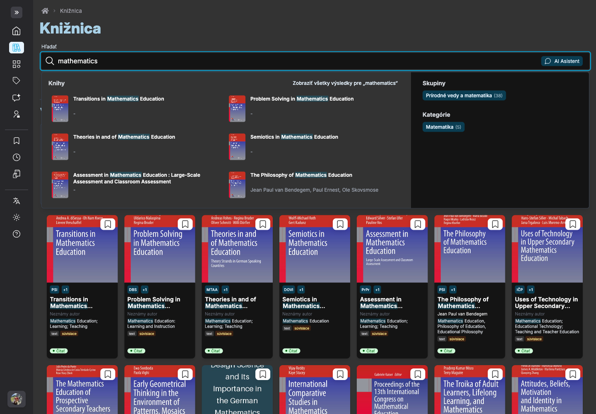
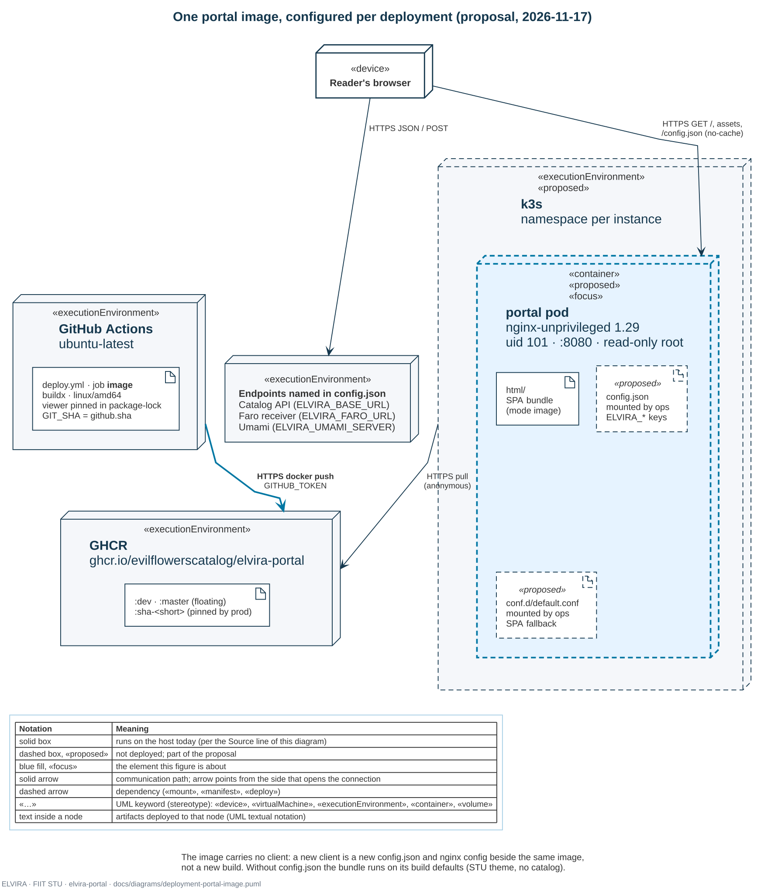
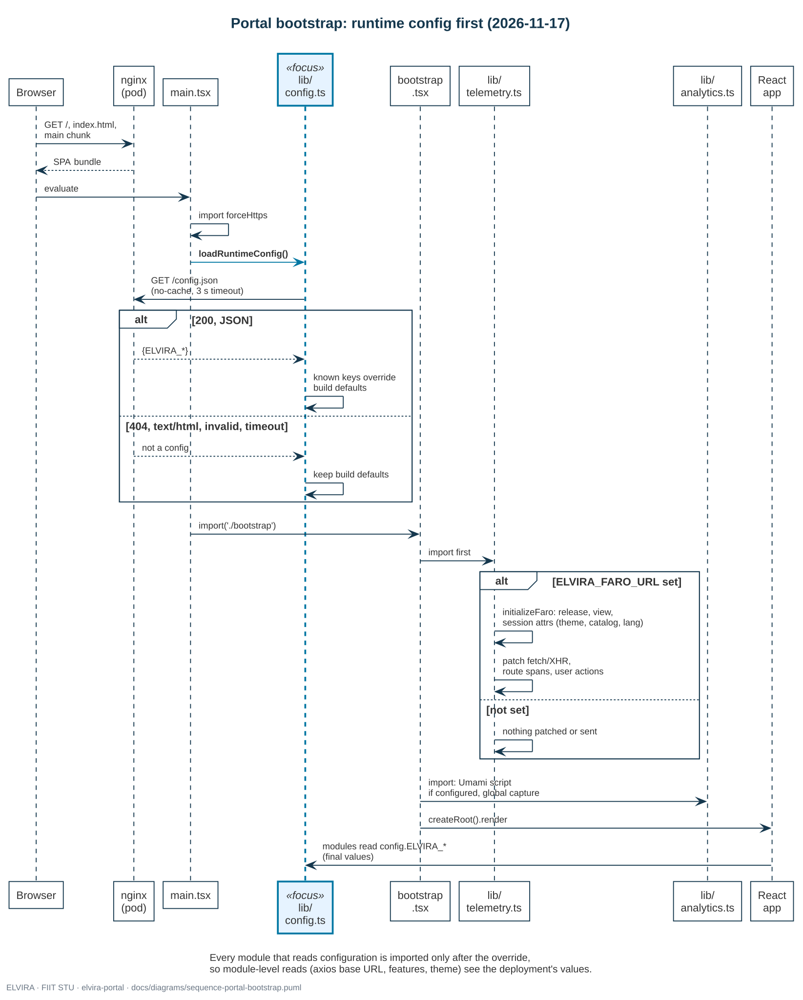
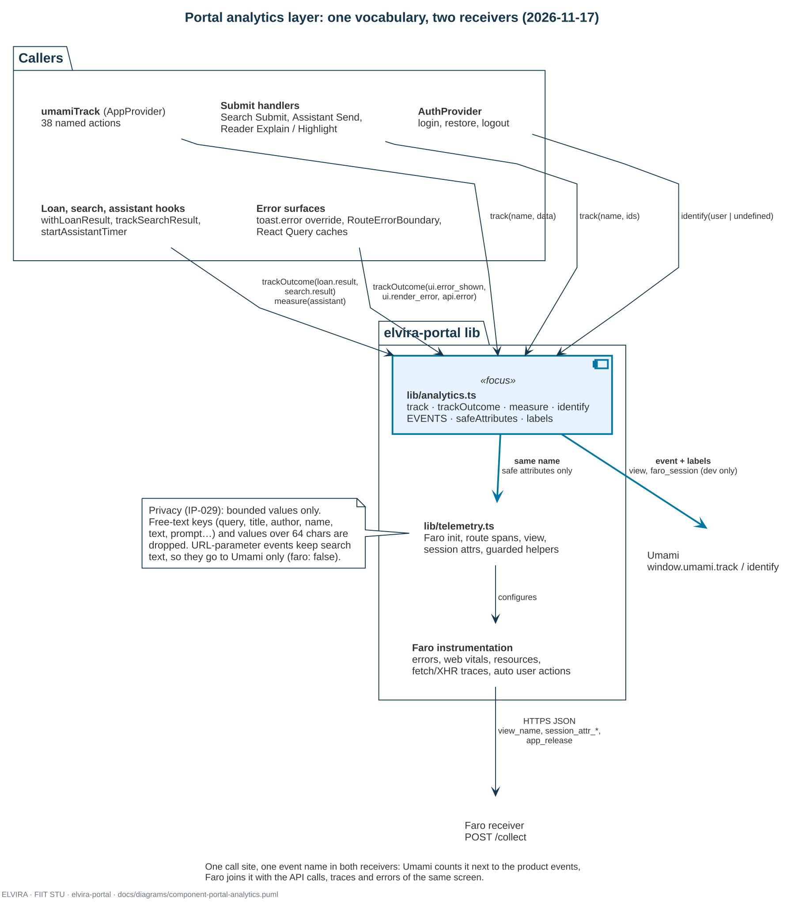

# Welcome to Elvira Portal! 📘 🏖

The web frontend for the **[EvilFlowers Catalog](https://github.com/EvilFlowersCatalog/EvilFlowersCatalog)** —
a digital academic library. Browse and search the catalog, borrow and read
DRM-protected (Readium LCP) titles, manage loans and reservation queues, and
chat with the built-in AI assistant.

Crafted with **React 19 + Vite** and **TypeScript**. Sit back and relax — the app
hot-reloads whenever you tweak any source file.



## Highlights

- **Discovery** — relevance-ranked search (diacritics optional, typo correction
  with "did you mean"), matched words highlighted in results, one-request
  type-ahead suggestions, filters with live counts (collections, categories,
  authors, language, year, availability), and infinite-scroll catalog browsing.
- **Lending** — borrow / renew / return flows and reservation queues with proper
  availability indicators (available · borrowed · reserved · unavailable).
- **Reading** — in-app reader (`@evilflowers/evilflowersviewer`) with annotations.
- **AI assistant** — conversational search & recommendations.
- **Multi-faculty theming** — per-catalog brand colors and logos (see below), plus
  a **light / dark mode** toggle.
- **Bilingual** — Slovak 🇸🇰 / English 🇬🇧 (`react-i18next`).
- **Accessible** — keyboard-operable controls with visible focus rings, dialog
  focus-traps, labeled inputs & icon buttons, `<html lang>` synced to the UI
  language, and WCAG-AA color contrast across every theme (light and dark).

## Tech stack

React 19 · TypeScript · Vite · Tailwind CSS (`darkMode: 'class'`) · react-router-dom v7 · @tanstack/react-query · react-i18next · axios

## Architecture & conventions

- **Path alias** — import from `@/…` (maps to `src/…`) instead of deep `../../../`
  relative paths. Configured in `vite.config.ts` and `tsconfig.json`.
- **Code-splitting** — every route is lazily loaded (`React.lazy` in
  `src/routes/BaseRoutes.tsx`) behind a `<Suspense>` boundary in `App.tsx`, and
  heavy vendors (the reader, markdown, i18n) are split into their own chunks
  via `build.rollupOptions.output.manualChunks`. The initial payload no longer
  ships the whole app.
- **Data fetching** — new read endpoints use **React Query**
  (`src/lib/reactQuery.ts` + `QueryClientProvider` in `main.tsx`). See
  `src/hooks/api/catalogs/useCatalogsQuery.ts` for the reference pattern: wrap a
  `useAxios()` call in `useQuery` with a stable `queryKey`. The older imperative
  `hooks/api/**` hooks (which return a bare async fetch function) are being
  migrated onto this pattern incrementally — both styles coexist.
- **Linting** — ESLint 9 flat config (`eslint.config.js`) with
  `react-hooks/rules-of-hooks` enforced. Prettier config in `.prettierrc.json`.

## Local development

```bash
npm install
npm run dev
```

Then glide over to `http://localhost:3000/` to explore. The dev server reads
`env/.env.development`.

### Available scripts

| Script | What it does |
| --- | --- |
| `npm run dev` | Start the Vite dev server (`http://localhost:3000/`) |
| `npm run build:dev` | Type-check + build in **development** mode (`env/.env.development`) |
| `npm run build:prod` | Type-check + build in **production** mode (`env/.env.production`) |
| `npm run build:stu` | Type-check + build in **stu** mode (`env/.env.stu`) |
| `npm run build:ku` | Type-check + build in **ku** mode (`env/.env.ku`, KU production) |
| `npm run dev:ku` | Dev server with the KU profile (put local overrides in `env/.env.ku.local`) |
| `npm run preview` | Serve the last build locally |
| `npm run typecheck` | Type-check without emitting (`tsc --noEmit`) |
| `npm run lint` | ESLint 9 (flat config) over `src` |
| `npm run lint:fix` | ESLint with `--fix` |
| `npm run format` | Prettier write over `src` |

> There is intentionally **no** `npm run start`. Use `npm run dev`.

## Build process

Run `npm run build:<mode>` — the mode selects which `env/.env.<mode>` file shapes
the build. Then `npm run preview` to serve it.

### One image, runtime configuration

`npm run build` (mode `image`) builds a bundle with no client in it; the `Dockerfile` serves it with
`nginx-unprivileged` (uid 101, port 8080, read-only root filesystem). CI pushes
`ghcr.io/evilflowerscatalog/elvira-portal` (`:dev`, `:master`, `:sha-<short>`).

Each deployment mounts `/usr/share/nginx/html/config.json` with any of the `ELVIRA_*` keys, plus its
nginx config as `/etc/nginx/conf.d/default.conf` (SPA fallback). The keys override the build-time values
before the app renders (`src/lib/config.ts`). A missing or invalid file leaves the build-time values, so
`npm run dev` and the static deploys work unchanged. Read configuration through `config`, never
`import.meta.env.ELVIRA_*`.

```json
{ "ELVIRA_BASE_URL": "https://api.e-knihy.ku.sk", "ELVIRA_CATALOG_ID": "1863182a-…", "ELVIRA_THEME": "ku" }
```





## Analytics and telemetry

`src/lib/analytics.ts` is the one layer for Umami and Grafana Faro: `track` (reader actions), `trackOutcome`
(`loan.result`, `search.result`, `ui.error_shown`, `ui.render_error`, `api.error`, …), `measure`, `identify`.
Umami events carry `view` (route pattern), and on development `faro_session` to join them with Faro
(not in production: Umami identifies the user, IP-029). Never put search text, titles, names or e-mails
into an event.



### Faro on an instance

Faro (`src/lib/telemetry.ts`) is on when the config has both of these:

| Key | Value |
|---|---|
| `ELVIRA_FARO_URL` | the public receiver, today `https://dev.elvira.stuba.sk/faro/collect` |
| `ELVIRA_FARO_API_KEY` | the receiver's app key (1Password `stu.observability.faro/api_key`) |
| `ELVIRA_FARO_ENVIRONMENT` | `development` or `production`; the image defaults to `production` |
| `ELVIRA_FARO_SAMPLE_RATE` | optional, `0`–`1` (default `1`) |

- The static deploys get these from the GitHub Environment at build time. The image gets them from `config.json`.
- The key goes out as `x-api-key`. It is not a secret, because it ships to every browser.
- What protects the receiver is its CORS origin list and the nginx and Alloy rate limits. **A new instance's
  origin must be added to the receiver's allowed origins**, or the browser blocks every POST. Today only
  `https://dev.elvira.stuba.sk` is allowed.
- A URL without a key leaves Faro off, with a console warning.

## Themes

`ELVIRA_THEME` picks the brand palette and logos (light & dark): `stu` (the default, also when unset or
unknown) or `ku` (Katolícka univerzita v Ružomberku).

Each theme exposes contrast-aware CSS variables in `src/main.css`
(`--color-primary`, `--color-primary-text`, `--color-on-primary`,
`--color-primary-dark`, `--color-primary-hover`, …) so text and buttons meet WCAG AA on every palette.
KU gold is a light fill, so it puts dark ink on the fill (`--color-on-primary`).

The institution logo of a theme (`public/assets/<theme>/stu/logo-{dark,light}.png`) is shown on the
sign-in page, linked to the institution (`src/utils/institution.ts`). KU follows its design manual
(ku.sk › Verejnosť a médiá › Dizajn manuál): colours from part 03 (gold Pantone 871 C `#D1A619`, black
`#1F1A17`, greys `#DEDEDD`/`#969594`), serif headings from part 02 (Palatino Linotype), and the logos
valid from 2025 (published on the same page; the PDF parts predate them).

## Portal features

Parts of the portal can be switched on or off at runtime in **Administration › Features**
(`src/features/features.ts`): assistant, library graph, full-text passages, publication contents, featured
collection, lending (LCP), help, interoperability, content policies, instance settings. The first layer
that says "off" wins:

1. the catalog's **capability** (e.g. no assistant model, no extraction index), reported by the catalog;
2. the catalog setting **`portal.features`** (`{"assistant": false}`), stored from the admin page;
3. the **build default**: `ELVIRA_FEATURES` (`assistant=off,graph=on` or `-assistant,+graph`), else
   `ELVIRA_EXPERIMENTAL_FEATURES` for experimental features, else on.

The catalog side (the `portal.features` key and the public read
`GET /api/v1/settings?public=true&include=capabilities`, no token) is
EvilFlowersCatalog#212; until it is deployed the build default applies (superusers already see stored values).
Gate new UI with `useFeature('<key>')`, routes with `<RequireFeature feature='<key>' />`.

## Deploy

- **elvira.stuba.sk / dev.elvira.stuba.sk** — GitHub Actions on push to `master` / `dev`
  (`.github/workflows/deploy.yml`).
- **KU production (e-knihy.ku.sk)** — the only KU instance; it runs the *dev* packages (`dev` branch +
  EvilFlowersViewer `develop`). Push to `dev`: the `deploy-ku` job in `.github/workflows/deploy.yml`
  builds with `npm run build:ku` (`env/.env.ku`), joins the private network, uploads a release and swaps
  `current` (last 5 kept). Rollback = re-run an older successful run. `https://e-knihy.ku.sk/version.json`
  names the live release.

  The host side (deploy account, network ACL, GitHub Environment `e-knihy.ku.sk`, `releases/` +
  `current` layout) is EvilFlowersCatalog/knowledge#83; the catalog's minimal-instance settings
  knowledge#84. For local development against KU's catalog, see knowledge#83 for the
  `env/.env.ku.local` value (`npm run dev:ku`).

## Environment variables

Elvira-specific variables:

- **`ELVIRA_BASE_URL`** — API base URL the frontend fetches all data from.
- **`ELVIRA_CATALOG_ID`** — the catalog whose data is shown. Each catalog maps to a
  faculty/department with its own theme and content.
- **`ELVIRA_THEME`** — faculty theme name (see the list above); selects logos and colors.
- **`ELVIRA_UMAMI_SERVER`** — analytics (Umami) server URL.
- **`ELVIRA_UMAMI_WEBSITE`** — Umami website ID for analytics.
- **`ELVIRA_EXPERIMENTAL_FEATURES`** — `true`/`false`; the build default of experimental features
  (see Portal features).
- **`ELVIRA_FEATURES`** — optional; per-feature build defaults, e.g. `assistant=off,graph=on`.
- **`ELVIRA_FEATURED_FEED_ID`** — optional; the collection (feed) shown as the themed row
  on the home page (an experimental feature). Empty or unset hides the row.

Prefer overriding these via bash rather than editing the `env/.env.*` files directly:

```bash
export ELVIRA_BASE_URL=base_url
export ELVIRA_CATALOG_ID=catalog_id
export ELVIRA_THEME=theme
export ELVIRA_UMAMI_SERVER=server_url
export ELVIRA_UMAMI_WEBSITE=website_id
export ELVIRA_EXPERIMENTAL_FEATURES=false

npm run build:prod
```

🔔 **Gentle reminder** 🔔 — clean up afterward:

```bash
unset ELVIRA_BASE_URL ELVIRA_CATALOG_ID ELVIRA_THEME \
      ELVIRA_UMAMI_SERVER ELVIRA_UMAMI_WEBSITE ELVIRA_EXPERIMENTAL_FEATURES
```

Let the adventure begin! 🚀
